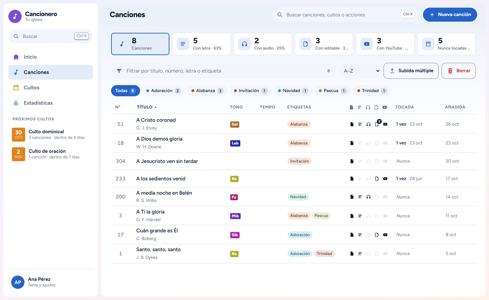
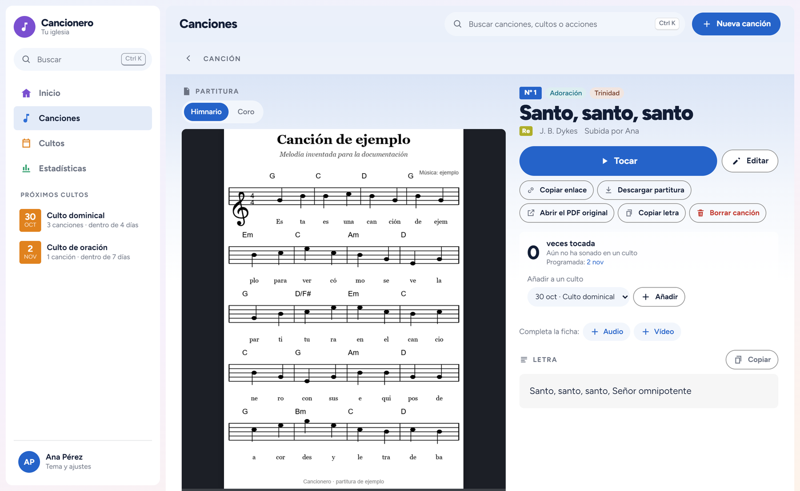
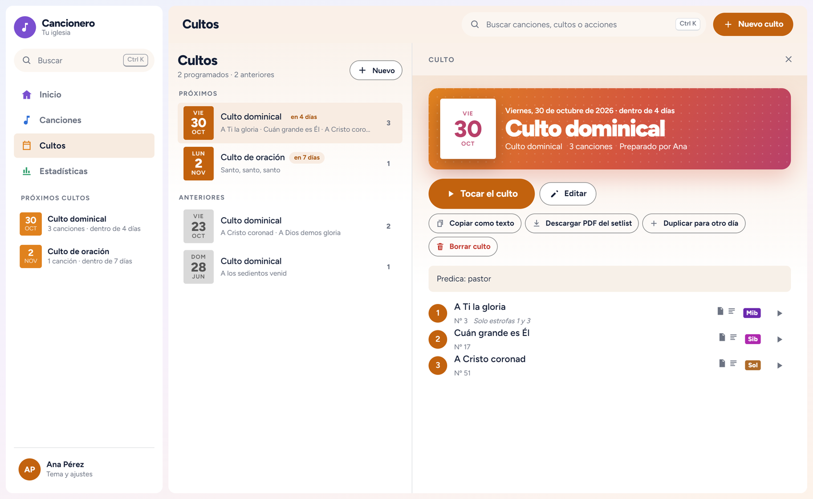
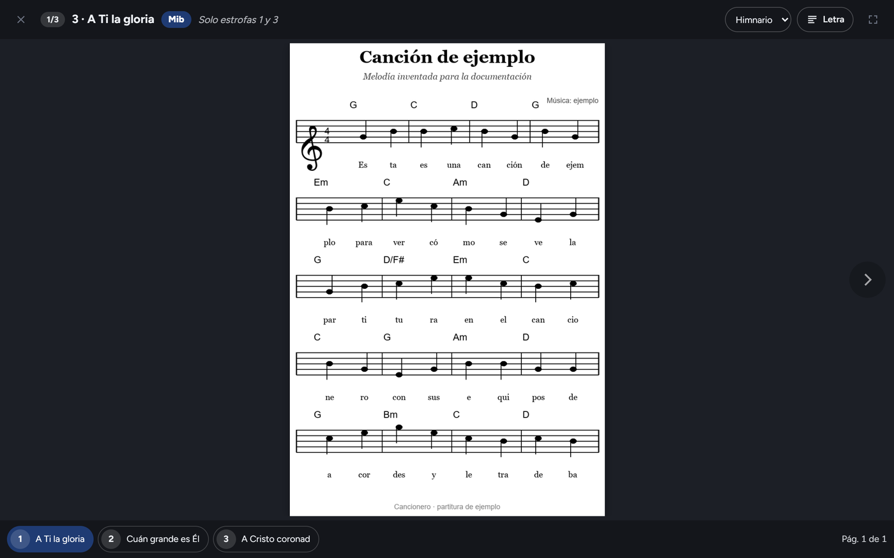
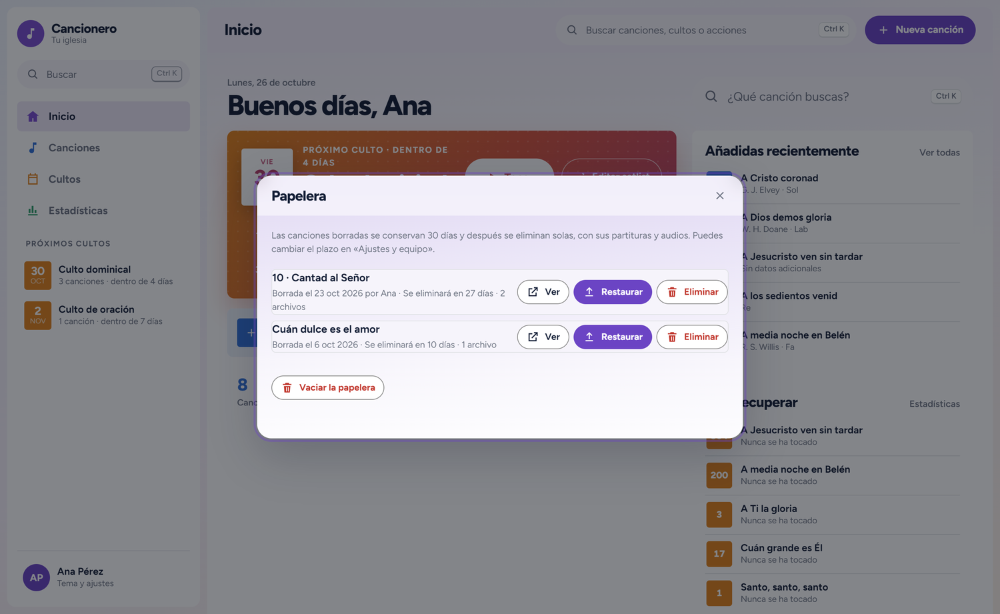
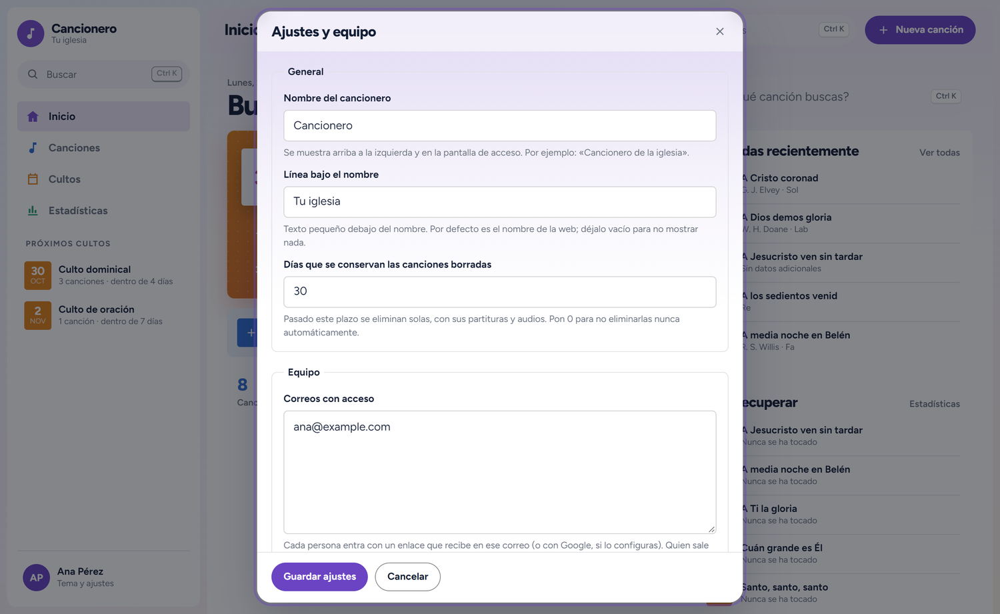
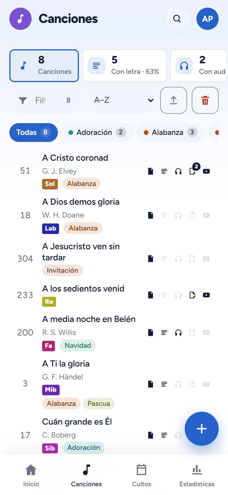

<p align="center">
  <picture>
    <source media="(prefers-color-scheme: dark)" srcset="docs/imagenes/logo/logo-oscuro.svg">
    
  </picture>
</p>

# Cancionero

*Versión en español: [README.md](README.md)*

A WordPress plugin to manage a **worship team's songbook**: songs with their scores (PDF or image), lyrics, audio,
editable scores, tempo, key and YouTube links; **services with their setlist**; a **play mode** for playing or singing
from a tablet, with metronome and video; statistics; several churches in one installation; backups; and team sign-in with Google or with an email link.

It is free software, meant to let any church or music group manage its own scores. The plugin is only the tool: it
**includes no songs or scores**; each installation brings its own. The interface is available in Spanish and English and
can be translated into other languages. In English, an installation without a name of its own calls itself "Songbook".

**Website, download and manual:** [cancionero.gersonrodrigo.com](https://cancionero.gersonrodrigo.com/en/) · [Download and install](https://cancionero.gersonrodrigo.com/en/descargar/) · [User manual](https://cancionero.gersonrodrigo.com/en/manual/)



## What it does

### Songs
- **Song page:** one or more scores (PDF or image), lyrics, notes for the team, audio, editable scores (MuseScore,
  MusicXML…), colored tags, key, tempo (BPM), hymnal number and YouTube videos. The page tells you what is missing
  ("Complete the song page").
- **Key per score:** each score can have its own key. On the song page and when playing you pick the key and see only its
  scores; the list shows every key of each song.
- **Main score:** if a song has several scores, the first one is the main one (the one used by default); change it with
  "Make main" on the song page.
- **Formatted lyrics:** an editor with bold, italic, underline, section titles (Verse 1, Chorus…) and refrain. It goes
  full screen while you type; typing a section name and pressing Enter turns it into a title, and there are quick buttons
  and shortcuts. A song can be saved **with lyrics only** and get its score later.
- **List and search:** search by title, number, author, lyrics or any key; filter by tag, key and resources (with
  YouTube, with audio, editable, never played, several keys…); sort by any column.
- **Many songs at once:** "Bulk upload" (drag many PDFs or images; the title, hymnal number and key are worked out from
  the file name), "Tag" several songs in one go and multiple delete.
- **Trash:** deleted songs go to a trash that administrators see in Settings and team → Trash: they can open them,
  restore them or delete them for good. The trash empties itself after N days (30 by default, configurable; 0 = never).
  When someone deletes a song, the administrators get an **email alert** with the song, its files, who deleted it and
  when (deletions made in a row arrive in a single email; it can be turned off in Settings and team → General).

### Play and sing
- **Play (play mode):** the score full screen on the tablet, with blank margins trimmed and two pages in landscape. Turn
  pages by swiping, tapping the sides, with the keyboard or a Bluetooth pedal; tapping the centre leaves only the music,
  and the screen stays on while you play.
- **Sing:** the same reader with each song's lyrics, at an adjustable size and scrolling by screens.
- **Metronome** (M key): starts at each song's tempo, with time signature, "Tap" to work out the tempo and sound that can
  be muted.
- **Video** (V key): the song's YouTube video in a floating panel, to rehearse at home. "Hide" keeps it playing, and
  moving to another song offers that song's video.
- Open them from a song page (**Play** and **Sing**) or from a service (**Play the service** and **Sing the service**,
  which go through the whole setlist).

### Services
- **Setlist:** the order of songs for each service, with key, note and chosen score per song; a countdown to the next
  service, a PDF of the setlist and "Copy as text". Services can be **private** (only their author sees them) and
  deleted services go to their own trash.
- **Exporting lyrics:** the lyrics of one song or of a whole setlist as a PDF sheet, a PowerPoint presentation, PDF slides
  (with background images an administrator uploads), OpenLyrics (OpenLP, FreeShow, Quelea…) or plain text.
- **Order of service:** the printed sheet with the order of the service (a header with the church logo and a table
  with the sections). Each service has its own, in its Order of service tab: it is filled in with the service's songs, the
  sections and titles can be changed (only for that service), with formatted text and a live preview, and it is exported
  as a PDF. A new service starts from the last order of service prepared; in Settings and team → Order of service only
  the logo and the header image are chosen.
- **Statistics:** services held, the most played songs, those not heard for a while, those never played and activity by
  month, over 3, 6 or 12 months or all time.

### Team and access
- **Access:** the "Worship team" role, sign-in with Google (Google Identity Services) or with an email link.
- **Welcome:** anyone added to the team list receives an email with the logo and a button that signs them
  straight into the songbook (single use, valid for 7 days), plus how to sign in later. From **Settings and team → Team**
  it can be sent again to the people you choose.
- **Activity:** under **Settings and team → Activity**, who signs in and how much the songbook is used: active people,
  sign-ins, days of use, how they sign in, from which device and on which days, with each person's details. Kept for
  12 months, no IP addresses.
- **Songbook administrators:** besides WordPress administrators, others can be named under **Settings and team**. They can
  change the settings, manage the team and delete songs (to the songbook trash).
- **Order-of-service managers:** the team can view and export the order of service of a service, but only managers
  (named under **Settings and team → Team**) and administrators can create and change it.

### Several churches
- One installation can serve **several churches**. Songs are shared (each person **adds** scores, videos or details but
  cannot change what others added), and each church has its own services, team and roles, tags, audio, usual key and
  main score for each song, statistics and order of service.
- The central administrator manages the churches under **Settings and team → Churches** (create, rename, archive and
  delete empty ones) and can make a tag or an audio file **universal** so every church sees it. With a single church
  none of this shows.

### Customization and data
- **Your own name:** the name of the songbook ("Our church songbook", etc.) is changed under **Settings and team →
  General**.
- **Visual themes:** Colors (default), Staff, Like the site, Pulse, Studio, Stage and Score.
- **Languages:** Spanish and English. Each person chooses their language and the notation for keys (Do-Re-Mi or C-D-E) in
  their account menu; by default the WordPress language is used. More languages can be added (see
  [docs/translate.en.md](docs/translate.en.md)).
- **Shortcut:** the songbook page can be added to the home screen (PC, Android, iPhone/iPad) with its icon.
- **Backups:** export and import all the content from Settings and team → Backups (songbook and WordPress
  administrators).
- **REST API** (`/wp-json/pieb/v1/`) covering everything the interface does, handy for bulk loading (see
  [docs/carga-masiva.en.md](docs/carga-masiva.en.md)).

It is shown on any page with the `[cancionero]` shortcode.

## Screenshots

Screenshots of the test bench, with invented data and an invented sample score.

| | |
|---|---|
|  |  |
| **Song page:** score, versions, lyrics, audio and video. | **Service and setlist:** order, keys, notes and a printable PDF. |
|  |  |
| **Play mode:** the score large on the tablet and quick switching between songs. | **Trash:** restore or permanently delete what was removed. |
|  |  |
| **Settings and team:** name, administrators, access and file protection. | **Phone:** the same list, adapted to the phone. |

## Requirements

WordPress 6.0 or later and PHP 7.4 or later. No additional plugins needed.

## Download

The easiest way is the [Download and install](https://cancionero.gersonrodrigo.com/en/descargar/) page: one button downloads the latest version
and below it are the steps to install and update it in WordPress.

From GitHub: if you only want to **use the plugin** and not the code, go to the **Releases** tab of this repository and download the
`pieb-cancionero-<version>.zip` file of the latest version. That is the one you upload to WordPress. Do **not** download
"Source code" or "Download ZIP" from the main page: they contain the whole project (test bench, tutorial, tools…) and
cannot be installed as a plugin as they are.

## Installation

1. Download the zip from the *Releases* (see above) or build it yourself: `python herramientas/empaquetar.py` → `dist/pieb-cancionero-<version>.zip`.
2. In WordPress: **Plugins → Add New → Upload Plugin** and select the zip.
3. Activate the plugin and create a page with the `[cancionero]` shortcode.
4. In the songbook's own **Settings and team**: name, administrators, team email list, Google sign-in (optional) and
   default theme.

To update: upload the new zip and choose **Replace current with uploaded**. Your data is not touched.

## File security

Scores may be under copyright, so they are **not served directly**. Since version 1.5.0 the files (scores, audio,
editable files and thumbnails) are stored in `wp-content/uploads/cancionero-privado/` and delivered through WordPress,
only to people who are signed in and have access to the songbook.

- **Apache:** the folder includes an `.htaccess` that forbids direct access. Check that your server allows `.htaccess`
  files (`AllowOverride`).
- **Nginx:** it ignores `.htaccess`. Add this rule to the site configuration and reload the server:

  ```nginx
  location ^~ /wp-content/uploads/cancionero-privado/ { deny all; }
  ```

- **Check:** under **Settings and team → Files** the plugin checks whether the server hands out the files
  without a session and warns you in red if it does.
- **Files from before 1.5.0:** the same section has a **Protect existing files** button, which moves them to the private
  folder in batches of 50. Make a backup first. Old direct links stop working.
- Anyone with access to the songbook can download the files (that is their purpose). If there is a cache or CDN in front
  of the site, exclude the addresses containing `?pcan_archivo=`.

## Repository structure

| Folder / file | What is in it |
|---|---|
| `pieb-cancionero/` | The plugin (the folder is named after the plugin in WordPress). |
| `pieb-cancionero/languages/` | Translations: the `.pot` template and, for each language, `.po`, `.mo` and `.json`. See [how to translate](docs/translate.en.md). |
| `banco-pruebas/` | A local page with simulated data to try the interface without WordPress (the "test bench"). |
| `tutorial/` | Animated tutorial with narration (self-contained HTML, in Spanish). The MP4 video is not versioned. |
| `docs/` | Guides: [architecture](docs/arquitectura.en.md), [bulk loading and data enrichment](docs/carga-masiva.en.md), [recovering the songbook](docs/guia-recuperar-cancionero.en.html), [translating Cancionero](docs/translate.en.md). |
| `herramientas/` | Package the plugin, manage translations (`i18n.py`), check PHP without PHP (`comprobar_php.py`), regenerate the screenshots and the tutorial's narration and video. |
| `CLAUDE.md` | Project context for picking the work back up (in Spanish; also useful for anyone new). |
| `CHANGELOG.md` | Version history (in Spanish). |
| `dist/` | The generated `.zip` (not versioned). |

## Development

- **Publishing a version:** change the version in `pieb-cancionero/pieb-cancionero.php` (the `Version:` header **and**
  `PIEB_CAN_VERSION`, so browsers download the new CSS and JS), note the change in `CHANGELOG.md`, run
  `python herramientas/empaquetar.py` and upload the zip to WordPress.
- **Regenerating the screenshots** in `docs/imagenes/` (and the image used to share the repository):
  `python herramientas/capturas.py` (needs `pip install playwright pillow` and Microsoft Edge). It only uses the test
  bench, never real data or scores.
- **Trying the interface without WordPress:** `python -m http.server 8765 --bind 127.0.0.1` in the repository root, then
  open `http://127.0.0.1:8765/banco-pruebas/index.html`. It accepts
  `?tema=colores|pentagrama|sitio|pulso|claro|escenario|papel`, `?idioma=en_US` (or any language with a compiled
  translation) and `?notacion=americana|latina`. File uploads and anything that depends on PHP can only be tested on a
  real WordPress.
- **Translations:** the texts in the code are in Spanish and are translated with gettext (text domain `pieb-cancionero`).
  `python herramientas/i18n.py extraer` updates the template and the `.po` files with new texts, `compilar` generates
  the `.mo` files, the JavaScript `.json` files and the test bench dictionaries, and `estado` shows what percentage is
  translated (needs `pip install -r herramientas/requirements.txt`). `empaquetar.py` already runs `compilar`. To add a
  language: [docs/translate.en.md](docs/translate.en.md).
- **PHP:** the original development machine has no local PHP environment: PHP code is reviewed by hand, with
  `python herramientas/comprobar_php.py` (balanced brackets and braces), and tested on WordPress. If you have PHP,
  `php -l` on each file is a better filter.
- **Publishing a Release:** merge into `main`, push and create the GitHub Release with the zip
  (`gh release create vX.Y.Z dist/pieb-cancionero-X.Y.Z.zip`), with notes in Spanish and English.
- More detail (data model, REST API, conventions): [docs/arquitectura.en.md](docs/arquitectura.en.md) and
  [CLAUDE.md](CLAUDE.md) (Spanish).

## Tutorial

`tutorial/tutorial-cancionero.html` has its narration embedded (in Spanish). To regenerate it or redo the video
(`pip install -r herramientas/tutorial/requirements.txt`, with Edge and ffmpeg installed):

1. `python herramientas/tutorial/grabar_locucion.py` (neural voice Elvira; it only sends the script text).
2. `python herramientas/tutorial/incrustar_locucion.py`
3. With the test bench running: `python herramientas/tutorial/grabar_video.py`
4. `python herramientas/tutorial/montar_video.py` → `tutorial/tutorial-cancionero-1080p.mp4`

## Data

The content (songs, scores, services, settings) lives in WordPress, **not in this repository**. Scores may be under
copyright: you are responsible for the ones you upload to your installation. To keep the songbook safe or move it to
another site: Settings and team → **Backups** (songbook and WordPress administrators). See
[docs/guia-recuperar-cancionero.en.html](docs/guia-recuperar-cancionero.en.html).

To load or complete many songs from a folder of files, see [docs/carga-masiva.en.md](docs/carga-masiva.en.md).

## Author and license

Copyright © Gerson Rodrigo Menéndez.

- **Code** (plugin, tools, test bench): [GPL-2.0-or-later](LICENSE), the usual WordPress license.
- **Documentation and tutorial** (`README`, `docs/`, `tutorial/`): [CC BY-SA 4.0](LICENSE-DOCS.txt).
- **Logo** (`docs/imagenes/logo/` and the header of the welcome email): CC BY-SA 4.0. The lettering uses the
  [Unbounded](https://fonts.google.com/specimen/Unbounded) typeface (SIL Open Font License), converted to outlines.

Creative Commons licenses are not meant for software; that is why the code uses the GPL (compatible with WordPress) and
only the texts and the tutorial use Creative Commons.

## Contributing

See [CONTRIBUTING.en.md](CONTRIBUTING.en.md). To translate Cancionero into another language, see
[docs/translate.en.md](docs/translate.en.md). Ideas, bug reports and improvements are welcome in *Issues* and *Pull
requests*.
