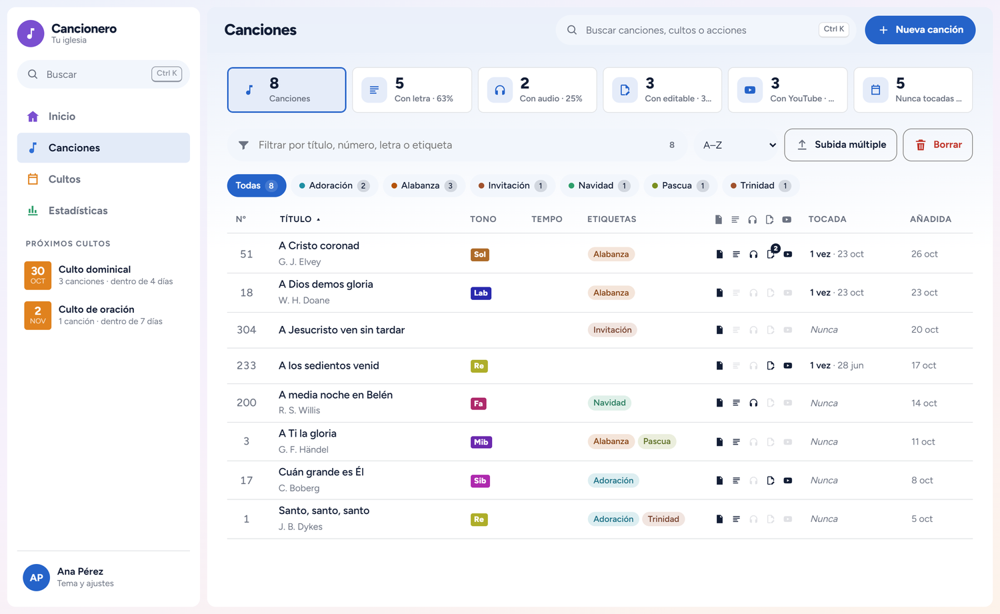
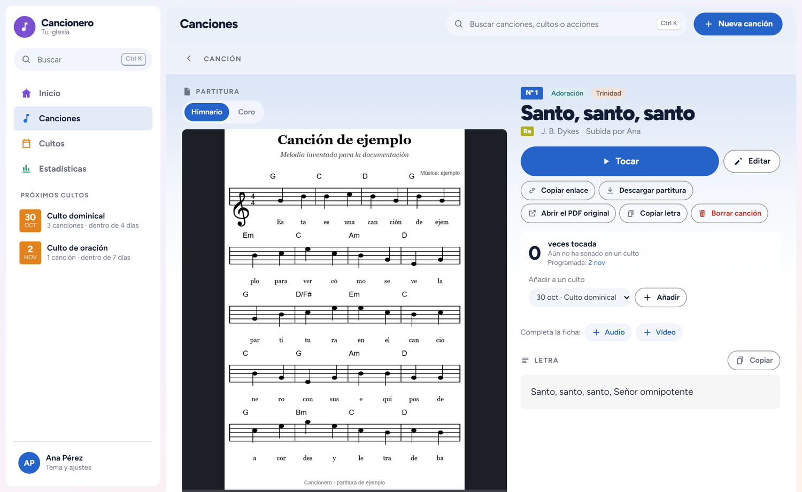
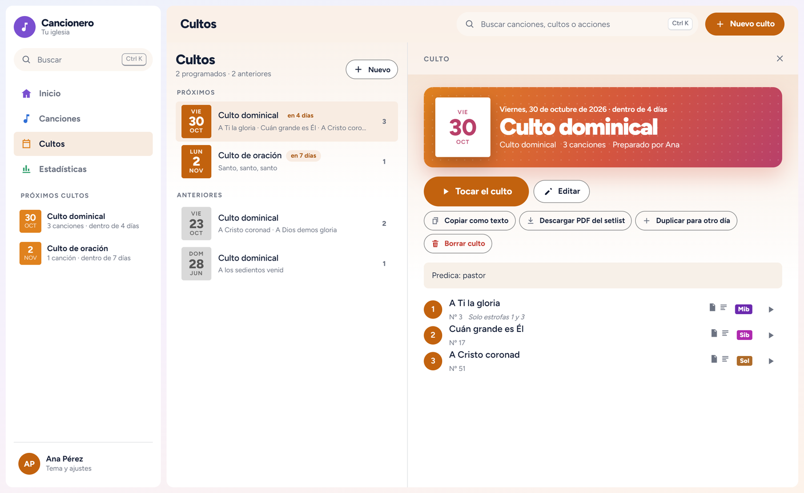
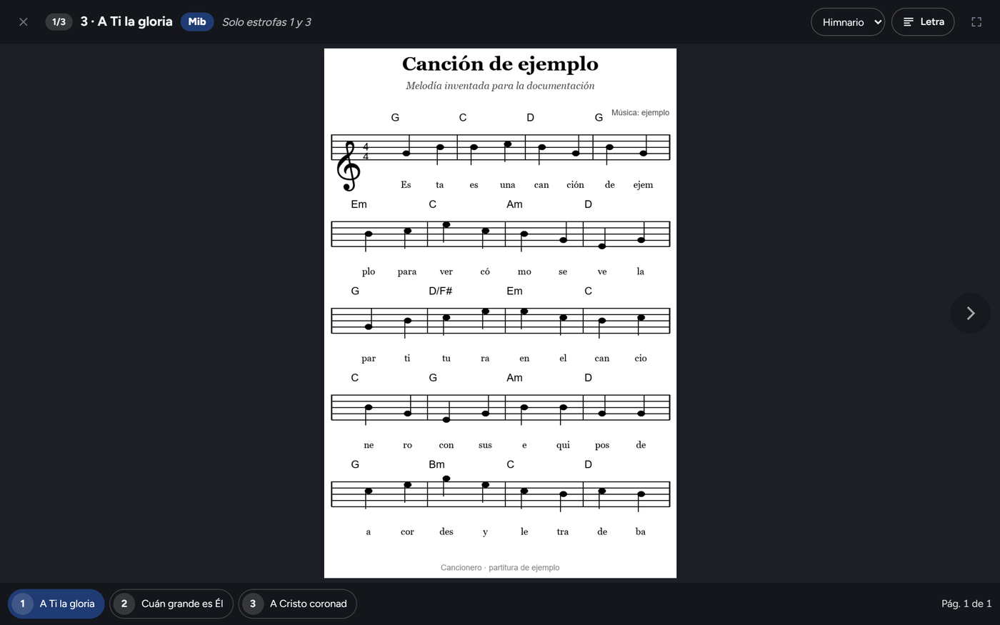
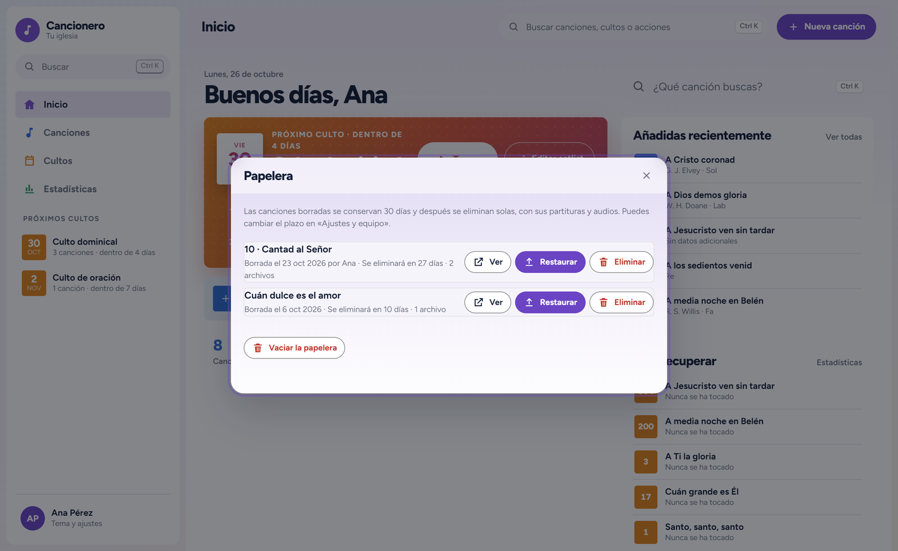
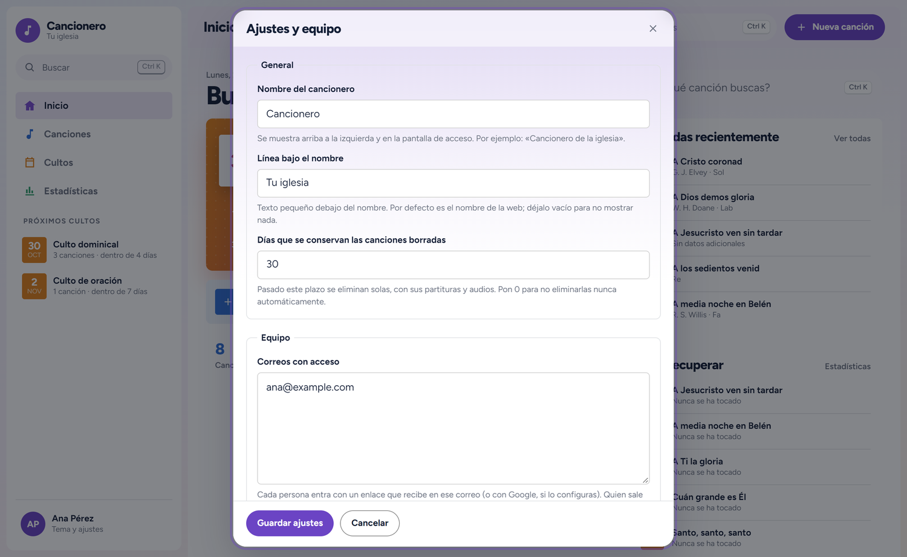
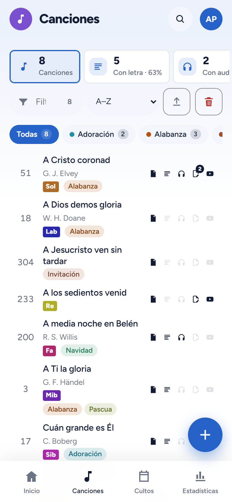

<p align="center">
  <picture>
    <source media="(prefers-color-scheme: dark)" srcset="docs/imagenes/logo/logo-oscuro.svg">
    
  </picture>
</p>

# Cancionero

*English version: [README.en.md](README.en.md)*

Plugin de WordPress para gestionar el **cancionero de un equipo de adoración**: canciones con partitura (PDF o imagen),
letra, audios, partituras editables, tempo, tonalidad y enlaces de YouTube; **cultos con su setlist**; un **modo culto**
para tocar desde la tableta; estadísticas; copias de seguridad; y acceso del equipo con Google o con enlace por correo.

Es software libre pensado para que cualquier iglesia o grupo musical gestione sus propias partituras. El plugin es solo
la herramienta: **no incluye ninguna canción ni partitura**; cada instalación aporta las suyas. La interfaz está en español e inglés, y se puede traducir a otros idiomas.



## Qué hace

- **Canciones:** una ficha por canción con una o varias partituras, letra, notas, audios, editables (MuseScore, MusicXML…),
  etiquetas de color, tonalidad, tempo (BPM), número de himnario y vídeos de YouTube.
- **Partitura principal:** si una canción tiene varias partituras, la primera es la principal (la que se usa por defecto);
  se cambia con «Hacer principal» en la ficha.
- **Papelera:** las canciones borradas van a una papelera que los administradores ven en Ajustes y equipo → Papelera: pueden abrirlas,
  restaurarlas o eliminarlas para siempre. Se limpian solas pasados N días (30 por defecto, configurable; 0 = nunca).
  Cuando alguien borra una canción, los administradores reciben un **aviso por correo** con la canción, sus archivos,
  quién la borró y cuándo (los borrados seguidos llegan en un solo correo; se desactiva en Ajustes y equipo → General).
- **Importación masiva:** «Subida múltiple» (arrastrar muchos PDF/imágenes de una vez; el título, el número de himnario
  y la tonalidad se deducen del nombre del archivo).
- **Cultos y setlists:** orden de canciones por culto, con tonalidad, nota y partitura elegida por canción, cuenta atrás al próximo culto
  y PDF del setlist.
- **Escaleta del culto:** la hoja impresa con el orden del culto (cabecera con el logo de la iglesia y una tabla con
  las secciones). Cada culto tiene la suya, en su pestaña Escaleta: se rellena con sus canciones, se pueden cambiar las
  secciones y los títulos (solo en ese culto) y se exporta en PDF. Un culto nuevo parte de la última escaleta preparada;
  en Ajustes y equipo → Escaleta solo se eligen el logo y la imagen de cabecera.
- **Visor / modo culto:** pantalla pensada para tableta, con la partitura grande y cambio rápido entre canciones.
- **Acceso:** rol «Equipo de adoración», inicio de sesión con Google (Google Identity Services) o con enlace por correo.
- **Bienvenida:** quien se añade a la lista del equipo recibe un correo con el logo y un botón que le deja dentro
  del cancionero (sirve una vez durante 7 días), y cómo entrar más adelante. Desde **Ajustes y equipo → Equipo** se puede reenviar a las personas que se elijan.
- **Accesos:** en **Ajustes y equipo → Accesos**, quién entra y cuánto se usa: personas activas, inicios de sesión, días
  de uso, cómo entran, desde qué dispositivo y qué días, con el detalle de cada persona. Se guardan 12 meses, sin IP.
- **Administradores del cancionero:** además de los administradores de WordPress, se pueden nombrar otros desde
  **Ajustes y equipo**. Pueden cambiar los ajustes, gestionar el equipo y borrar canciones (a la papelera de WordPress).
- **Nombre propio:** el nombre del cancionero («Cancionero de la iglesia», etc.) se cambia en **Ajustes y equipo → General**.
- **Temas visuales:** Colores (por defecto), Pentagrama, Como la web, Pulso, Estudio, Escenario y Partitura.
- **Idiomas:** español e inglés. Cada persona elige su idioma y la notación de las tonalidades (Do-Re-Mi o C-D-E) en el
  menú de su cuenta; por defecto se usa el idioma de WordPress. Se pueden añadir más idiomas (ver
  [docs/traducir.md](docs/traducir.md)).
- **Copias de seguridad:** exportar e importar todo el contenido desde Ajustes y equipo → Copias de seguridad (administradores del cancionero y de WordPress).

Se muestra en cualquier página con el shortcode `[cancionero]`.

## Capturas

Capturas del banco de pruebas, con datos y una partitura de ejemplo inventados.

| | |
|---|---|
|  |  |
| **Ficha de canción:** partitura, versiones, letra, audios y vídeo. | **Culto y setlist:** orden, tonalidad, notas y PDF para imprimir. |
|  |  |
| **Modo culto:** la partitura grande en la tableta y cambio rápido entre canciones. | **Papelera:** restaurar o eliminar para siempre lo que se borró. |
|  |  |
| **Ajustes y equipo:** nombre, administradores, acceso y protección de los archivos. | **Móvil:** la misma lista, adaptada al teléfono. |

## Requisitos

WordPress 6.0 o superior y PHP 7.4 o superior. No necesita plugins adicionales.

## Descargar

Si solo quieres **usar el plugin** y no el código, ve a la pestaña **Releases** de este repositorio y descarga el archivo
`pieb-cancionero-<versión>.zip` de la última versión. Ese es el que se sube a WordPress. **No** descargues «Source code» ni
«Download ZIP» de la página principal: contienen todo el proyecto (banco de pruebas, tutorial, herramientas…) y no sirven
para instalar el plugin tal cual.

## Instalación

1. Descarga el zip de las *Releases* (ver arriba) o genéralo tú: `python herramientas/empaquetar.py` → `dist/pieb-cancionero-<versión>.zip`.
2. En WordPress: **Plugins → Añadir nuevo → Subir plugin** y selecciona el zip.
3. Activa el plugin y crea una página con el shortcode `[cancionero]`.
4. En **Ajustes y equipo** del propio cancionero: nombre, administradores, lista de correos del equipo, acceso con Google
   (opcional) y tema por defecto.

Para actualizar: sube el zip nuevo y elige **Reemplazar el actual con el subido**. Los datos no se tocan.

## Seguridad de los archivos

Las partituras pueden tener derechos de autor, así que **no se sirven directamente**. Desde la versión 1.5.0 los archivos
(partituras, audios, editables y miniaturas) se guardan en `wp-content/uploads/cancionero-privado/` y se entregan a través
de WordPress, solo a quien ha iniciado sesión y tiene acceso al cancionero.

- **Apache:** la carpeta incluye un `.htaccess` que prohíbe el acceso directo. Comprueba que tu servidor permite
  archivos `.htaccess` (`AllowOverride`).
- **Nginx:** ignora `.htaccess`. Añade esta regla a la configuración del sitio y recarga el servidor:

  ```nginx
  location ^~ /wp-content/uploads/cancionero-privado/ { deny all; }
  ```

- **Comprobación:** en **Ajustes y equipo → Archivos** el plugin comprueba si el servidor entrega los
  archivos sin sesión y te avisa en rojo si es así.
- **Archivos de antes de la 1.5.0:** el mismo apartado tiene el botón **Proteger archivos existentes**, que los mueve a
  la carpeta privada por tandas de 50. Haz antes una copia de seguridad. Los enlaces directos antiguos dejan de funcionar.
- Cualquier persona con acceso al cancionero puede descargar los archivos (es su función). Si hay una caché o CDN
  delante de la web, excluye las direcciones con `?pcan_archivo=`.

## Estructura del repositorio

| Carpeta / archivo | Qué hay |
|---|---|
| `pieb-cancionero/` | El plugin (la carpeta se llama como el plugin en WordPress). |
| `banco-pruebas/` | Página local con datos simulados para probar la interfaz sin WordPress. |
| `tutorial/` | Tutorial animado con locución (HTML autocontenido). El vídeo MP4 no se versiona. |
| `docs/` | Guías: [arquitectura](docs/arquitectura.md), [carga masiva y enriquecimiento de datos](docs/carga-masiva.md), [recuperar el cancionero](docs/guia-recuperar-cancionero.html), [traducir el cancionero](docs/traducir.md). Cada guía tiene versión en inglés (`.en`). |
| `pieb-cancionero/languages/` | Traducciones: plantilla `.pot` y, por idioma, `.po`, `.mo` y `.json`. Ver [cómo traducir](docs/traducir.md). |
| `herramientas/` | Empaquetar el plugin, gestionar las traducciones (`i18n.py`), comprobar el PHP sin PHP (`comprobar_php.py`), regenerar las capturas y la locución y el vídeo del tutorial. |
| `CLAUDE.md` | Contexto del proyecto para retomar el trabajo (también útil para cualquier persona nueva). |
| `CHANGELOG.md` | Historial de versiones. |
| `dist/` | El `.zip` generado (no se versiona). |

## Desarrollo

- **Publicar una versión:** cambia la versión en `pieb-cancionero/pieb-cancionero.php` (cabecera `Version:` **y**
  `PIEB_CAN_VERSION`, así los navegadores descargan los CSS y JS nuevos), anota el cambio en `CHANGELOG.md`, ejecuta
  `python herramientas/empaquetar.py` y sube el zip a WordPress.
- **Regenerar las capturas** de `docs/imagenes/` (y la imagen para compartir el repositorio): `python herramientas/capturas.py`
  (necesita `pip install playwright pillow` y Microsoft Edge). Usa solo el banco de pruebas, nunca datos ni partituras reales.
- **Probar la interfaz sin WordPress:** `python -m http.server 8765 --bind 127.0.0.1` en la raíz del repositorio y abre
  `http://127.0.0.1:8765/banco-pruebas/index.html`. Admite `?tema=colores|pentagrama|sitio|pulso|claro|escenario|papel`,
  `?idioma=en_US` (o cualquier idioma con traducción compilada) y `?notacion=americana|latina`.
  Las subidas de archivos y todo lo que dependa de PHP solo se prueban en un WordPress real.
- **Traducciones:** los textos del código están en español y se traducen con gettext (dominio `pieb-cancionero`).
  `python herramientas/i18n.py extraer` actualiza la plantilla y los `.po` con los textos nuevos, `compilar` genera los
  `.mo`, los `.json` de JavaScript y los diccionarios del banco de pruebas, y `estado` muestra qué porcentaje está
  traducido (necesita `pip install -r herramientas/requirements.txt`). `empaquetar.py` ya ejecuta `compilar`. Para
  añadir un idioma: [docs/traducir.md](docs/traducir.md).
- **PHP:** no hay entorno PHP local en el equipo de desarrollo original: el código PHP se revisa a mano, con
  `python herramientas/comprobar_php.py` (paréntesis y llaves equilibrados), y se prueba en WordPress. Si tienes PHP,
  `php -l` sobre cada archivo es un filtro mejor.
- **Publicar una Release:** fusionar en `main`, subir y crear la Release de GitHub con el zip
  (`gh release create vX.Y.Z dist/pieb-cancionero-X.Y.Z.zip`), con notas en español e inglés.
- Más detalle (modelo de datos, API REST, convenciones): [docs/arquitectura.md](docs/arquitectura.md) y
  [CLAUDE.md](CLAUDE.md).

## Tutorial

`tutorial/tutorial-cancionero.html` lleva la locución incrustada. Para regenerarla o rehacer el vídeo
(`pip install -r herramientas/tutorial/requirements.txt`, Edge y ffmpeg instalados):

1. `python herramientas/tutorial/grabar_locucion.py` (voz neuronal Elvira; solo envía el texto del guion).
2. `python herramientas/tutorial/incrustar_locucion.py`
3. Con el banco de pruebas en marcha: `python herramientas/tutorial/grabar_video.py`
4. `python herramientas/tutorial/montar_video.py` → `tutorial/tutorial-cancionero-1080p.mp4`

## Datos

El contenido (canciones, partituras, cultos, ajustes) vive en WordPress, **no en este repositorio**. Las partituras
pueden tener derechos de autor: eres responsable de las que subas a tu instalación. Para guardar o llevar el cancionero a otra web:
Ajustes y equipo → **Copias de seguridad** (administradores del cancionero y de WordPress). Ver
[docs/guia-recuperar-cancionero.html](docs/guia-recuperar-cancionero.html).

Para cargar o completar muchas canciones desde una carpeta de archivos, ver [docs/carga-masiva.md](docs/carga-masiva.md).

## Autor y licencia

Copyright © Gerson Rodrigo Menéndez.

- **Código** (plugin, herramientas, banco de pruebas): [GPL-2.0-or-later](LICENSE), la licencia habitual de WordPress.
- **Documentación y tutorial** (`README`, `docs/`, `tutorial/`): [CC BY-SA 4.0](LICENSE-DOCS.txt).
- **Logo** (`docs/imagenes/logo/` y la cabecera del correo de bienvenida): CC BY-SA 4.0. Las letras son de la
  tipografía [Unbounded](https://fonts.google.com/specimen/Unbounded) (SIL Open Font License), pasadas a trazos.

Las licencias Creative Commons no están pensadas para software; por eso el código va con GPL (compatible con WordPress)
y solo los textos y el tutorial con Creative Commons.

## Contribuir

Ver [CONTRIBUTING.md](CONTRIBUTING.md). Para traducir el cancionero a otro idioma, [docs/traducir.md](docs/traducir.md). Las ideas, errores y mejoras son bienvenidos en *Issues* y *Pull requests*.
